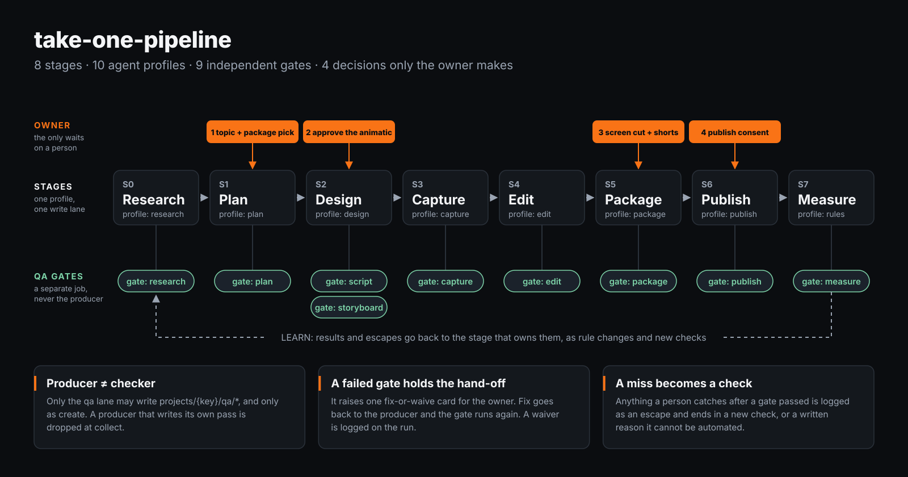
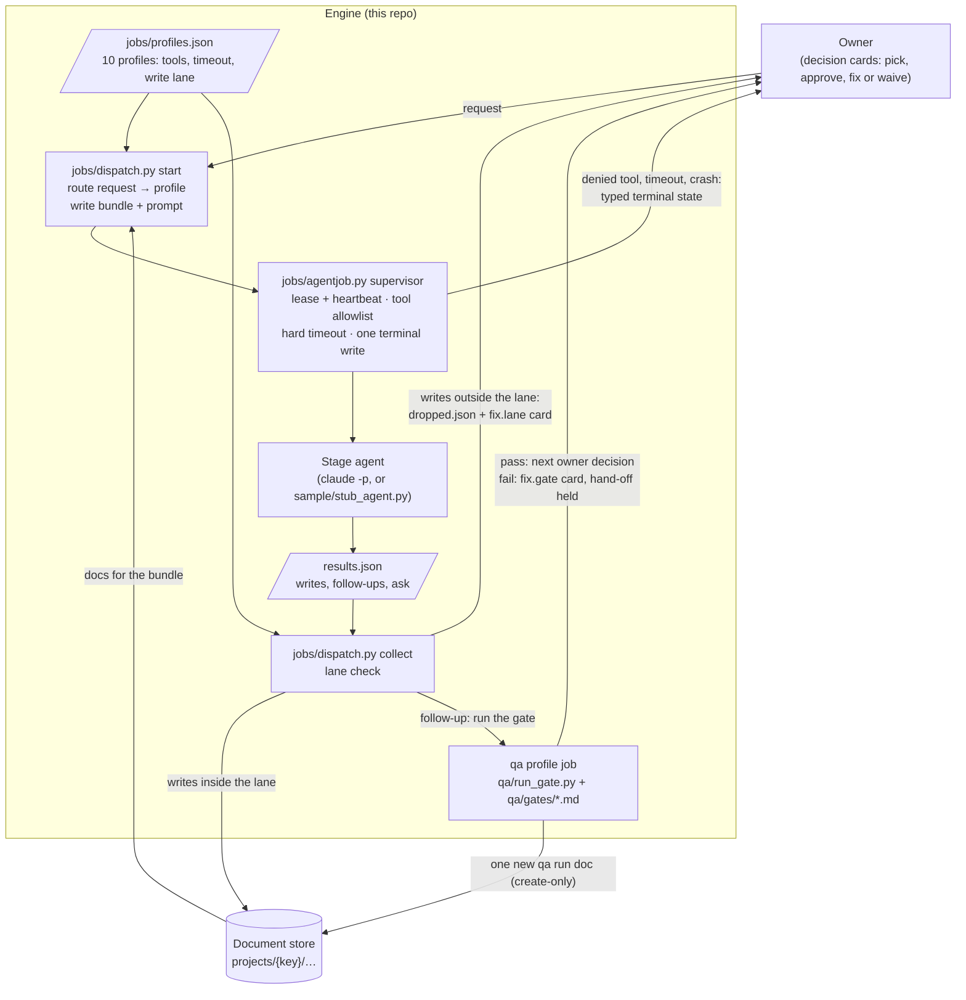

# take-one-pipeline

A multi-agent content pipeline where every stage hands off through an independent QA gate, and four decisions stay with a person.



This is the engine of Take One, the system I use to produce long-form videos, their shorts and their posts: the jobs
contract, the dispatcher, the ten agent profiles, the nine gate specs and the document schema. It ships with a small
fictional project (a home coffee-roasting episode) and a stub agent, so the whole loop runs on a laptop with no model,
no account and no API key.

## What it does

- **Runs each stage as a supervised, headless agent job.** A job holds a lease while it is alive, runs with a fixed
  tool allowlist, has a hard timeout, and gets exactly one terminal state written by the supervisor, not by the agent.
- **Gives every agent a write lane, and enforces it.** An agent never touches the document store. It hands back a list
  of writes; anything outside its profile's lane is dropped, saved to `dropped.json` and raised as a decision card.
- **Checks every hand-off with a separate QA job.** The producing agent cannot pass its own gate: only the `qa`
  profile may write gate runs, and only as new documents.
- **Stops for a person at four points, and only four:** topic and package pick, approving the design, screening the
  cut, and consent to publish. A failed gate adds a fifth kind of stop: fix it or waive it, on the record.
- **Turns misses into checks.** Anything a person catches after a gate passed is logged as an *escape* and must end
  in a new check or a written reason it cannot be automated.

## Architecture



The three documents that define it:

| File | What it fixes |
|---|---|
| [`JOBS-CONTRACT.md`](JOBS-CONTRACT.md) | How an unattended agent job starts, stays alive, and ends. Lease, allowlist, one terminal write, the reaper. |
| [`PIPELINE.md`](PIPELINE.md) | Who owns each stage, what gate it passes, where a person decides, how results route back. |
| [`SCHEMA.md`](SCHEMA.md) | The document tree, who may write each path, and the shapes the engine depends on. |

## Quick start

Needs Python 3 and a POSIX system (the supervisor uses `ps`, process groups and hard links). Nothing to install for
the sample run.

```bash
git clone https://github.com/AustinGailey/take-one-pipeline
cd take-one-pipeline

python3 sample/run_sample.py          # clean run: two stages, two gates, stops at the owner's approval (exit 0)
python3 sample/run_sample.py --bad    # the agent hands back a bad script: the gate holds it (exit 1)
```

The tests need pytest:

```bash
python3 -m venv .venv && .venv/bin/pip install pytest
.venv/bin/python -m pytest -q         # 6 tests, about 15 seconds
```

What the sample does and does not prove: the dispatcher, the supervisor, the profiles, the lane check and the two
gate checkers are the real code paths. The agent is a stub that copies a fixture instead of thinking
(`sample/stub_agent.py`), and the owner's answer is pre-recorded (`sample/project/owner-answers.json`).
`sample/run_sample.py` plays the part of the owner's web page: it files requests, applies the writes that survive the
lane check to a folder of JSON files, and raises the decision cards.

Output of the `--bad` run, from the design stage on (a sample run with the stub agent):

```text
S2 Design (script)
  design  job sj-r-003 started (skill episode-design, timeout 1800 s)
          done: Wrote script s1 and checked it myself. It is ready to record.
          applied  merge  projects/kc-001/stages/design
          applied  merge  projects/kc-001/stages/script
          applied  set    projects/kc-001/deliverables/script/versions/s1
          DROPPED  projects/kc-001/stages/script  (fields outside the lane: frozen (page-owned))
          DROPPED  projects/kc-001/qa/script-self-check  (outside this stage's lane)
          raised   decisions/lane-sj-r-003  [fix.lane]
  qa      job sj-r-004 started (skill content-qa, timeout 900 s)
          working: Bash: Run the script gate
          done: The script gate FAILED 2 checks: stage_directions, claims_sourced.
          applied  create projects/kc-001/qa/script-20261112T193849

  HELD at the script gate (qa/gates/script.md). 2 failing checks:
    FAIL  stage_directions   2 production notes in speakable text: c2-02 'On screen:'; c2-03 '[Cut to close-up of the beans]'
    FAIL  claims_sourced     2 numeric claims without source/opinion: …
  raised decisions/fix-kc-001-script-… [fix.gate]: fix (back to the producer, gate re-runs) or waive (logged).
```

## How a gate works

A gate is a markdown spec plus a checker. The spec is the contract a reviewer can read; the checker is what runs.
[`qa/gates/script.md`](qa/gates/script.md) is the script gate, unchanged in structure from production:

| Check | Threshold | Fails when |
|---|---|---|
| `script_present` | every chapter resolves to script lines | a chapter has only talking points |
| `runtime` | words ÷ 150 wpm within ±15 % of the target length | outside the band |
| `experiment_share` | lines marked as experiments ≤ 30 % | over 30 %, or an undefined experiment id |
| `stage_directions` | 0 production notes in text that will be spoken | any hit (`[Cut to …]`, `On screen:`, `Callout`, …) |
| `community_cta` | the close ends on the standard call to action | missing, or a booking pitch is spoken |
| `claims_sourced` | every numeric claim carries a source or is framed as opinion | any unsourced number |

Each gate file also says what it does **not** automate and why (for the script gate: whether it sounds like the
presenter, and whether the hook is any good), and lists the escapes that added checks to it.

What happens around the checker:

1. The producing agent finishes and lists a follow-up: "run the script gate". It cannot do more than ask. Its lane in
   [`jobs/profiles.json`](jobs/profiles.json) does not include `projects/{key}/qa/*`.
2. The follow-up is routed to the `qa` profile and runs as its own supervised job.
   [`qa/run_gate.py`](qa/run_gate.py) refuses a run whose producer is the qa profile.
3. The checker reads the stage documents from the job's bundle, never the producer's own verdict files, and writes a
   report with every check, pass or fail.
4. The job hands back one write: a **new** document `projects/{key}/qa/{runId}`. The lane is create-only, so a later
   run cannot overwrite an earlier failure.
5. Pass: the next owner decision is raised. Fail: one `fix.gate` card is raised and the hand-off is held until it is
   answered. *Fix* sends a ticket back to the producing stage and the gate runs again. *Waive* is the owner's call and
   is recorded on the run.

On that last point the production rule is "gates warn, the owner decides": a gate can stop the line, but it cannot
overrule the person. A waived failure that later turns out to matter is counted as an escape.

Two of the nine gates have their checkers in this repo (`plan`, `script`). The other seven are published as specs;
their checkers depend on media tools and rulebooks that are not here.

## Escapes

An escape is a defect that got past a gate: something the owner or the audience caught after the gate said pass.
Each one is a row in [`qa/escapes.csv`](qa/escapes.csv):

```text
date, episode, stage, defect, caught_by, gate_gap, fix, new_check
```

`gate_gap` is the honest part: why the gate missed it. `new_check` is the obligation: the check that now catches it,
or the reason it cannot be automated. Three examples from the log:

| Defect | Why the gate missed it | What changed |
|---|---|---|
| Stage directions were read aloud on camera | no check looked at speakable text for production notes | `stage_directions` in the script gate |
| A short's hook "passed" with 2 of 3 words heard | the check allowed fuzzy 2-of-3 matches | all 3 words, in order, after an explicit mishear list |
| "The motion graphics look low effort" | taste, not automatable | recorded as such; handled by a human review step, not a check |

The log has 14 rows. It is the real log with project codes and topic words replaced by the fictional project's. One
row names a check (`runtime_lines`) as built that is not in the published `script_check.py`; the adapter fix the same
row describes is in `qa/run_gate.py`. I left the row as logged rather than tidy it.

## What is measured

Only what you can count in this repo:

| Figure | Value | How to reproduce |
|---|---|---|
| Agent profiles | 10 | `python3 -c "import json;print(len(json.load(open('jobs/profiles.json'))['profiles']))"` |
| Gate specs | 9 | `ls qa/gates/*.md \| grep -v README \| wc -l` |
| Gate checkers runnable here | 2 of 9 | `plan`, `script` in `qa/checks/` |
| Logged escapes | 14 | `tail -n +2 qa/escapes.csv \| wc -l` |
| Tests | 6 | `pytest -q`; one asserts the profile and gate counts above |

No outcome metrics are published here: no gate pass rates, no time saved, no cost per run, no audience results. The
sample run is a test run with a stub agent and says nothing about model quality. `JOBS-CONTRACT.md` mentions that the
production copy was exercised against a real agent CLI; those runs are not reproduced in this repo and no numbers from
them are claimed.

## Limits

- **The agents' skills are not included.** Each profile names a skill (the instructions a stage agent follows). Those
  files, the stage rulebooks and the media tooling stay private. The stub agent stands in for them.
- **Seven of nine gate checkers are specs only**, as above.
- **The web app is not included.** In production the owner works in a browser page that files requests, shows live
  job state and decision cards, and applies the lane-checked writes. Here `sample/run_sample.py` does that job in
  about 250 lines against JSON files. The scheduled sweep that applies results when the page is closed is also not
  included.
- **The document store is a folder.** No concurrency control, no version pins. The production contract pins agent-side
  writes to a document version; that is described in `SCHEMA.md` and not implemented here.
- **The permission system is the agent CLI's.** The supervisor passes the allowlist to `claude -p` and reacts to
  denials in its event stream. With the stub, the denial event is simulated; the supervisor's reaction is real.
- **POSIX only**, tested on macOS with Python 3.14. Not tested on Linux or Windows.
- **Trimmed.** `jobs/dispatch.py` and `qa/run_gate.py` are subsets of the production files (asset upload hand-offs
  and seven gates removed). `PIPELINE.md` and `SCHEMA.md` are condensed. Names, brands and topics are fictional.

## Part of a set

I build internal AI platforms. The other pieces:

- [mcp-gateway](https://github.com/AustinGailey/mcp-gateway): single sign-on, role-based tool access and an audit log for MCP servers
- [tokenwise](https://github.com/AustinGailey/tokenwise): LLM cost gateway with caching and a savings ledger
- [runway](https://github.com/AustinGailey/runway): planner that runs coding agents under a token budget
- [take-one-pipeline](https://github.com/AustinGailey/take-one-pipeline): multi-agent pipeline with independent QA gates
- [lodestar](https://github.com/AustinGailey/lodestar): reliability layer for agent-built software
- [claude-cost-engineering](https://github.com/AustinGailey/claude-cost-engineering): prompt caching as a team default

## License

MIT. See [LICENSE](LICENSE).
